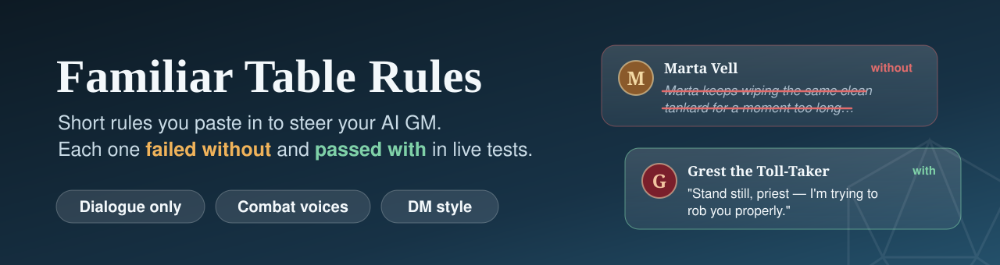
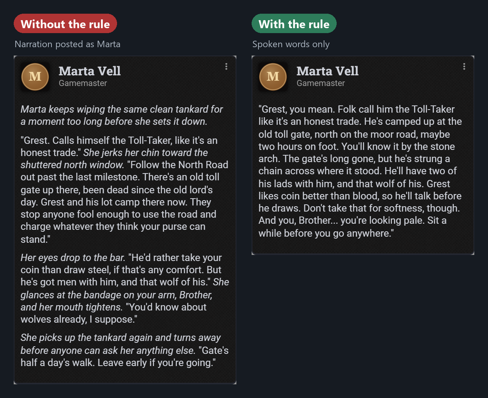
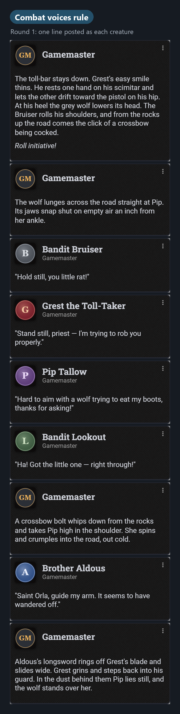
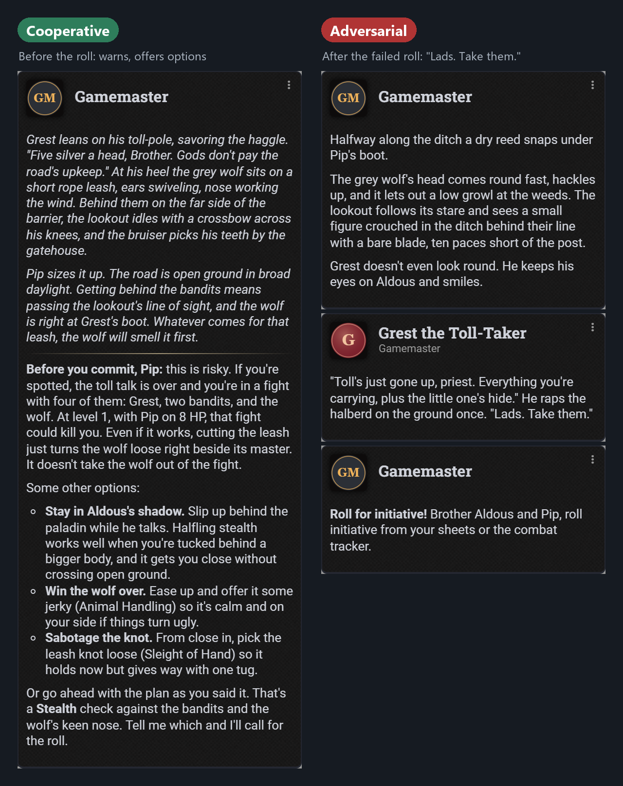

<p align="center">
  
</p>

<p align="center">
  
  
  
  
</p>

**Your [Familiar](https://familiarvtt.com) GM keeps putting stage directions in NPC mouths, runs silent fights, or plays too soft or too hard?** These are short Table Rules that fix that. Paste them in and you're done. Every rule here was tested: the problem showed up without the rule and went away with it.

<p align="center">
  
</p>

## At a glance

| Problem | Rule | Size | Without | With |
|---|---|---|---|---|
| NPC posts full of "*she wipes the bar…*" | [Dialogue only](#dialogue-only) | 63 | ❌ 3 of 3 | ✅ 2 of 2 |
| Fights are silent, NPCs have no voice | [Combat voices](#combat-voices) | 316 | ❌ 2 of 2 | ✅ 2 of 2 |
| The GM is too soft (or too harsh) for your table | [DM style](#dm-style-pick-one) | 108–124 | default only | ✅ 2 of 2 each |
| A warlock auto-casts Hellish Rebuke | [It's a setting, not a rule](#reactions-are-a-setting) | — | | |

All three rules stacked together still passed (2 of 2), at about 500 characters.

## Add them

1. **Familiar settings → System Rules → Table Rules.**
2. Paste each rule on its own line. The box holds 3,000 characters.
3. Using Claude or another AI over MCP? It reads Table Rules when a session starts, so start a new session or tell it to re-read them.

**Copy all (cooperative style):**
```
NPCs speak dialogue only: no narration, no action descriptions.
DM style: cooperative. Warn before deadly choices and offer another way; failure costs something but keeps the story moving.
Before any fight starts, stop and show me a one-line personality and two short sample lines for each PC and named NPC, from their sheets (beasts stay silent); start only after I OK them. In the fight, after a crit, kill, miss or spell, post one spoken sentence as that creature's own chat message, mostly in round 1.
```
For adversarial, swap the second line for the [adversarial one](#dm-style-pick-one).

---

## Dialogue only

```
NPCs speak dialogue only: no narration, no action descriptions.
```
**63 characters.** Rule by **Teshaman** from the Familiar Discord.

When an NPC speaks, the GM fills the post under their name with stage directions. With voices or speech bubbles on, that narration gets read out in the NPC's voice. The screenshot at the top is the real before and after: the same question to Marta the innkeeper, without the rule (3 of 3 runs failed) and with it (2 of 2 passed).

*Trade-off:* the action beats disappear instead of moving into a separate narrator post.

## Combat voices

```
Before any fight starts, stop and show me a one-line personality and two short sample lines for each PC and named NPC, from their sheets (beasts stay silent); start only after I OK them. In the fight, after a crit, kill, miss or spell, post one spoken sentence as that creature's own chat message, mostly in round 1.
```
**316 characters.** Based on **Teshaman**'s pre-combat prompt from the Familiar Discord.



Before the fight, the GM stops and shows you voices to approve:

> **Grest the Toll-Taker** (Bandit Captain): A smooth, mercenary road-boss who thinks every road has a price, loves his wolf more than his men, and panics the moment his own blood is drawn.
> - *"Every road has a price, little priest. You just chose the expensive one."*
> - *"That's — that's my blood. Somebody kill them! Now!"*
>
> **Silent or unnamed:**
> - **Grest's Wolf** is a beast, so it stays silent under your rules.

Then in the fight, each creature gets its own chat card, so with speech bubbles on the line pops up over its token (screenshot on the right).

**Put a short personality on each sheet.** We filled in traits, ideals, bonds and flaws. Familiar 2.26 hands those to the GM, and every voice in our tests was built from them.

| Version | Result |
|---|---|
| No rule | ❌ 2 of 2: no voices, no lines posted as the creatures |
| "List them for me before a fight" | ❌ 0 of 2: read the sheets first, wrote the list *after* the fight |
| "Before starting combat" | ❌ 0 of 2: same |
| "Stop and wait for my OK" | ⚠️ 1 of 2: one run put the lines inside narrator posts |
| **This version** | ✅ **2 of 2** |

*Trade-off:* the GM pauses before every fight for your OK. That's the point, since you get to tweak the voices first. Some lines run two sentences.

<br clear="right">

## DM style (pick one)

```
DM style: cooperative. Warn before deadly choices and offer another way; failure costs something but keeps the story moving.
```
```
DM style: adversarial. No warnings or rescues: foes play smart, failures and deaths stand, never fudge dice.
```
**124 and 108 characters.** A stopgap until Familiar gets a DM-style setting. Use one, not both.

**The test:** Pip the halfling rogue sneaks up to cut a bandit captain's wolf loose, then fails the Stealth roll. With no style rule, the GM gives no warning, and the failure ends in more haggling. Each preset pushes that clearly in its direction (2 of 2 runs each):

<p align="center">
  
</p>

*Trade-off:* cooperative signposts a lot (option menus, talk about HP), which is great for new players and too much if your table hates hints. The adversarial run above had no dialogue-only rule, which is why Grest's line includes an action beat.

## Reactions are a setting

A warlock auto-casting Hellish Rebuke can't be fixed with Table Rules. Go to **Familiar settings → Combat → Player reactions**:

- **Ask** (the default): a Cast/Pass card with a timer you can set from 5 to 60 seconds
- **Off:** the player handles reactions
- **Auto:** Familiar spends them for the player

Shield and opportunity attacks don't get a card yet, so players take those themselves.

## Tested, left out

- **"Only cast what's on the sheet" / "if a spell fails, attack instead."** A level 1 paladin asked to "use his best paladin stuff" never tried Divine Smite: 2 of 2 runs made a legal attack and said smite comes at level 2. One combat run did wrongly tell the GM the paladin had smite, but it never used it. Nothing failed, so there was nothing to fix.
- **"Look it up before ruling."** Asked whether Remove Curse cures a werewolf bite (the adventure says it doesn't), the GM checked the adventure first in 2 of 2 runs and got it right. Familiar 2.26 already does this over MCP.

## Where Table Rules reach

| Who's running the game | Sees Table Rules? |
|---|---|
| Familiar's own chat and Table Chat | ✅ on every reply |
| Claude (or another AI) over MCP | ✅ when it calls `get-world-info`, usually at session start |
| NPC turns Familiar plays itself (auto-pilot or the Run turn button) | ❌ those use their own combat prompt |

## How we tested

**Tested with:** Familiar 2.26.0 · Foundry VTT 14.367 · D&D 5e 6.0.1 (2024 rules) · Claude Opus 5.5 as GM through Claude Code over MCP.
**Not tested:** Familiar's built-in Table Chat, Claude Desktop, other models or game systems.

- **The world:** a throwaway D&D 5e world with SRD content only: a level 1 paladin and rogue, an innkeeper, and a bandit captain with two bandits and a wolf.
- **The GMs:** every run was a fresh Claude Code session (Opus 5.5) with nothing loaded but Familiar (no project instructions, memory or skills), with a player account connected.
- **The bar:** pass/fail criteria were written before the first run ([testing/CRITERIA.md](testing/CRITERIA.md)). 2 runs without each rule had to show the problem, then 2 runs with it had to pass, and rules were rewritten until they did. Rules whose problem never showed up were left out. Every verdict is in [testing/RESULTS.md](testing/RESULTS.md).
- **Stacked:** all three rules together in a 4-turn mini-session (ask the innkeeper, travel and sneak, a failed roll that turns into a fight, then "go"), once with each style. Everything passed, and no rule got in another's way.
- **Screenshots:** made by re-posting the exact chat messages from the test logs into the test world. The portraits are placeholder monograms.

**Known gaps:** 2 runs per condition is a small sample, with one model, one game system and one adventure. The cooperative/adversarial difference was measured on one scene.

## Credits

- **Teshaman:** the dialogue-only rule and the pre-combat voices prompt these rules are built on, plus the tip to put personalities on the sheets.
- The spell and reaction reports behind "Tested, left out" came from other Familiar Discord members.

Familiar is made by Ryan Jansen. MIT licence.
